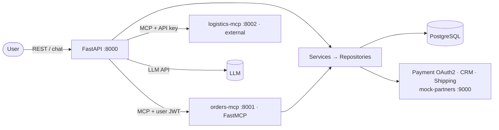

# AI Order Management Agent

A teaching project that grows a tiny MCP demo into a production-shaped backend: **FastAPI + FastMCP + PostgreSQL + LLM tool calling**, with shared service/repository layers, external API connectors and an external MCP server.

> The original prototype (two toy MCP servers + a LangChain client) is preserved with a code review in [archive/v0-basic-mcp-demo/](archive/v0-basic-mcp-demo/REVIEW.md).


More diagrams: [docs/00-architecture-and-learning-path.md](docs/00-architecture-and-learning-path.md).

## Quick start (Docker Compose)

Requirements: Docker + Compose v2. An LLM key is only needed for `/agent/chat` (everything else works without).

```bash
cp .env.example .env            # edit LLM_API_KEY (Groq/OpenAI/Ollama, any OpenAI-compatible endpoint)
docker compose up --build       # db → migrate (alembic + seed) → mock-partners → mcp servers → api
```
Then open **<http://localhost:8000/docs>** → *Authorize* with `staff@example.com` / `staff12345`.

```bash
TOKEN=$(curl -s -X POST localhost:8000/api/v1/auth/token -d 'username=staff@example.com&password=staff12345' | jq -r .access_token)

curl -s -X POST localhost:8000/api/v1/orders -H "Authorization: Bearer $TOKEN" \
  -H 'Idempotency-Key: demo-0001' -H 'content-type: application/json' \
  -d '{"customer_email":"ada@example.com","items":[{"sku":"KB-100","quantity":2}]}' | jq

curl -s localhost:8000/api/v1/agent/chat -H "Authorization: Bearer $TOKEN" -H 'content-type: application/json' \
  -d '{"message":"How many MN-300 are in stock? Order one for ada@example.com and track shipment AC12345678."}' | jq
```
Services / ports: API `8000` · orders MCP `8001/mcp` · logistics MCP `8002/mcp` · mock partners `9000` · Postgres `5432`.
> Port 8000 busy? Change the mapping in `docker-compose.yml` (`"8010:8000"`).

## Run locally without Docker (SQLite)

```bash
uv venv --python 3.12 && uv pip install -r pyproject.toml --group dev      # or: pip install -e . pytest ...
cp .env.example .env
alembic upgrade head && python -m app.seed
uvicorn mock_services.app:app --port 9000 &
python -m external_mcp.logistics_server --port 8002 &
python -m app.mcp_server.server --transport http --port 8001 &
uvicorn app.main:get_app --factory --port 8000
```
MCP over stdio (e.g. for a desktop MCP client): `python -m app.mcp_server.server --transport stdio`.

## Tests

```bash
pytest -q                       # ~90 tests, no network, no API keys, ~45 s
pytest tests/test_04_05_mcp_fastmcp.py -v
```
| File | Teaches |
|---|---|
| [test_01_fastapi.py](tests/test_01_fastapi.py) | routing, validation, errors, middleware, CORS, background tasks, concurrency, OpenAPI/versioning |
| [test_02_dependency_injection.py](tests/test_02_dependency_injection.py) | Depends, caching, yield, class-based deps, overrides, injected clients |
| [test_03_architecture.py](tests/test_03_architecture.py) | layers, transactions, races, idempotency, state machine, RBAC, pagination, logging |
| [test_04_05_mcp_fastmcp.py](tests/test_04_05_mcp_fastmcp.py) | discovery, schemas, structured output, errors, context, HTTP + JWT auth, scopes |
| [test_06_connectors.py](tests/test_06_connectors.py) | retries/backoff, breaker, OAuth2 refresh, transformation, secrets, external MCP |
| [test_07_integration_agent.py](tests/test_07_integration_agent.py) | LLM tool loop over MCP, RBAC through the agent, degradation, LLM client |

## Learn it in order

| Chapter | Topic |
|---|---|
| [00](docs/00-architecture-and-learning-path.md) | Architecture diagrams & progressive sequence |
| [01](docs/01-fastapi.md) | FastAPI |
| [02](docs/02-dependency-injection.md) | Dependency Injection |
| [03](docs/03-backend-architecture.md) | Backend architecture (layers, SQLAlchemy/Alembic, auth, idempotency, observability) |
| [04](docs/04-mcp.md) | Model Context Protocol |
| [05](docs/05-fastmcp.md) | FastMCP (incl. Docker deployment) |
| [06](docs/06-connectors.md) | Custom connectors (REST, MCP, PostgreSQL, CRM, payment) |
| [07](docs/07-integration.md) | The integrated AI Order Management Agent |
| [08](docs/08-interview-guide.md) | Interview preparation guide |
| [09](docs/09-api-reference.md) | REST + MCP reference, demo users, failure-injection triggers |

Every chapter follows the same template per topic: concept → why it exists → execution flow → minimal example → where it lives in this repo → mistakes & production notes → trade-offs → tests, and ends with 10 scenario-based interview questions.

## Repository map

```
app/
  main.py                 FastAPI factory (lifespan, middleware, routers, /health /ready /metrics)
  container.py            composition root (engine, connectors, LLM)
  api/                    deps (DI), errors, middleware, v1 routers, v2 router
  core/                   settings, errors, security (JWT/RBAC), observability
  db/                     ORM models, engine/pool, unit of work
  repositories/           SQL only
  services/               business rules (shared by REST and MCP)
  schemas/                Pydantic DTOs (also MCP tool schemas)
  connectors/             base toolkit, payment, crm, shipping, reporting (PostgreSQL), external MCP
  mcp_server/server.py    FastMCP server (tools, resources, prompt, auth, middleware)
  agent/                  LLM client, MCP tool hub, agent loop, CLI
external_mcp/             third-party style MCP server (logistics)
mock_services/            simulated payment (OAuth2), CRM, shipping with failure injection
alembic/                  migrations
docker/initdb/            read-only reporting DB role
tests/                    one file per chapter
archive/                  v0 prototype + review
```

## Configuration

All settings are environment variables (see [.env.example](.env.example) and [app/core/config.py](app/core/config.py)). Secrets can be supplied as files: set `JWT_SECRET_FILE=/run/secrets/jwt` (works for every secret field). Key variables: `DATABASE_URL`, `REPORTING_DATABASE_URL`, `JWT_SECRET`, `LLM_API_KEY`/`LLM_BASE_URL`/`LLM_MODEL`, `MCP_SERVER_URL`, `EXTERNAL_MCP_URL`, `EXTERNAL_MCP_API_KEY`, `PAYMENT_*`, `CRM_*`, `SHIPPING_*`, `HTTP_TIMEOUT_SECONDS`, `RETRY_MAX_ATTEMPTS`, `BREAKER_FAILURE_THRESHOLD`.

## Known limitations (deliberate, documented)
- Charge and DB commit are not atomic (see [chapter 3.4](docs/03-backend-architecture.md) for the outbox/reconciliation answer).
- HS256 shared secret + password grant are lab simplifications; production should use an IdP with JWKS.
- Circuit-breaker state and the token cache are per process.
- OpenTelemetry has spans but no exporter configured, and trace-context propagation to outbound calls is described, not wired.
- The agent has not been exercised against a live LLM in this repo's test suite (scripted LLM only); try it with your key.
