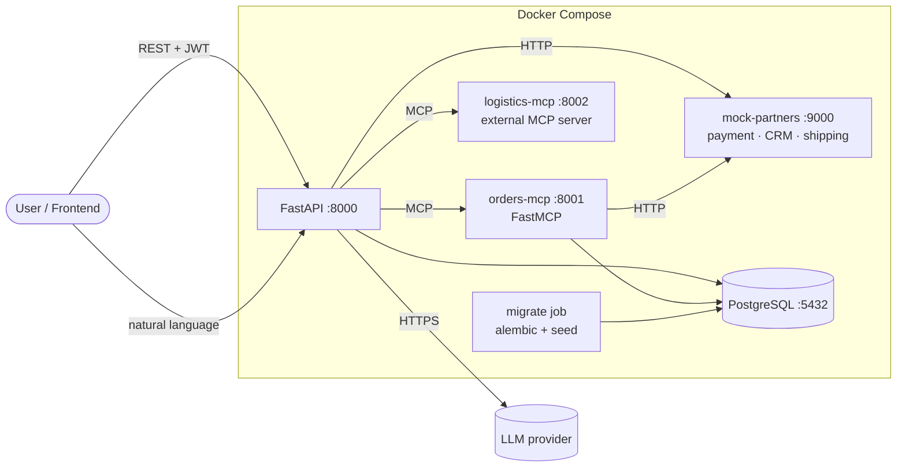
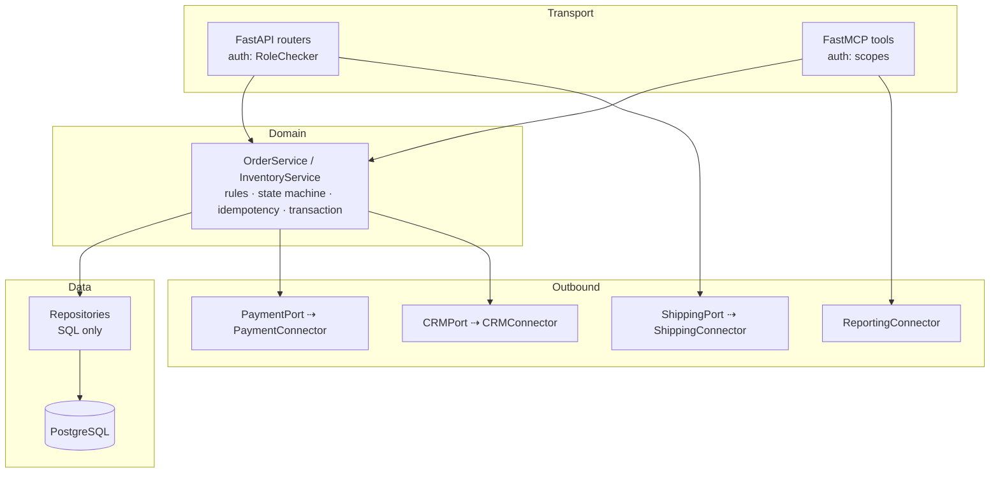
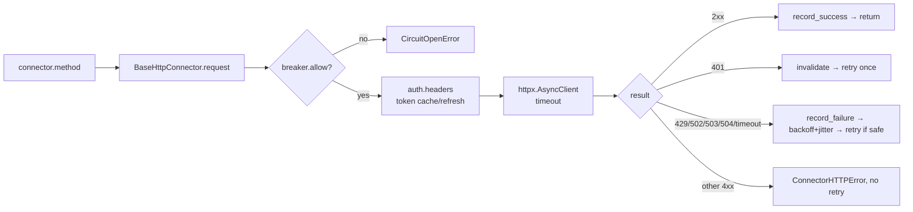

# Architecture & Learning Path

## Progressive implementation sequence

Each stage only uses ideas introduced earlier. The code for every stage is in the final project; the "Introduced" column says what to read first.

| # | Stage | Introduced (files) | Prerequisite concepts |
|---|---|---|---|
| 0 | Configuration, errors, security primitives | [core/](../app/core/) | none |
| 1 | FastAPI: app factory, routers, validation, errors, middleware | [main.py](../app/main.py), [api/](../app/api/) | stage 0 |
| 2 | Dependency Injection & composition root | [api/deps.py](../app/api/deps.py), [container.py](../app/container.py) | 1 |
| 3 | Persistence & layers: models, migrations, repositories, services | [db/](../app/db/), [repositories/](../app/repositories/), [services/](../app/services/), [alembic/](../alembic/) | 1, 2 |
| 3b | Auth/RBAC, idempotency, observability | [core/security.py](../app/core/security.py), [core/observability.py](../app/core/observability.py) | 3 |
| 4 | MCP concepts, external MCP integration | [connectors/mcp_external.py](../app/connectors/mcp_external.py), [external_mcp/](../external_mcp/) | 3 |
| 5 | FastMCP server over the *same* services | [mcp_server/server.py](../app/mcp_server/server.py) | 2, 3, 4 |
| 6 | Connectors: auth, retries, breaker, transformation | [connectors/](../app/connectors/), [mock_services/](../mock_services/) | 2, 3 |
| 7 | Agent: LLM tool calling over MCP | [agent/](../app/agent/) | 4, 5, 6 |
| 8 | Packaging: Docker Compose | [Dockerfile](../Dockerfile), [docker-compose.yml](../docker-compose.yml) | all |

Suggested reading order: chapter text → the listed files → the matching test file → break something and watch the test fail.

## System context



## Layering (same for REST and MCP)


Rule: arrows only point downward. Transports never touch repositories; services never import FastAPI/FastMCP; connectors never contain business rules.

## Connector internals



## Data model

```mermaid
erDiagram
  USERS { int id PK; string email UK; string password_hash; string role }
  PRODUCTS { int id PK; string sku UK; string name; int price_cents; int stock "CHECK >= 0" }
  ORDERS { string id PK; string customer_email; string status; int total_cents; string payment_ref; string crm_contact_id; datetime created_at }
  ORDER_ITEMS { int id PK; string order_id FK; int product_id FK; string sku; int quantity; int unit_price_cents }
  IDEMPOTENCY_KEYS { int id PK; string key; int user_id; string request_hash; string order_id FK }
  ORDERS ||--|{ ORDER_ITEMS : contains
  PRODUCTS ||--o{ ORDER_ITEMS : "sold as"
  ORDERS ||--o| IDEMPOTENCY_KEYS : "created by"
```
(`idempotency_keys` has a UNIQUE `(key, user_id)`.)

## Where each requirement lives
See the matrix in [Chapter 7](07-integration.md#71-what-we-are-building-and-why-this-shape) and the per-topic "In this project" notes in each chapter.
