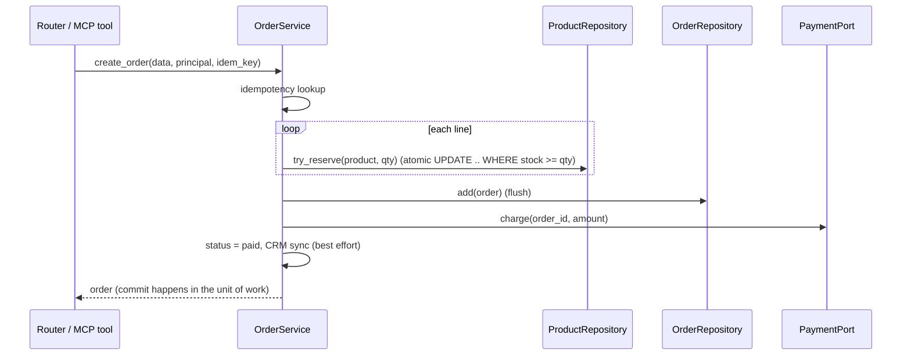

# Chapter 3: Backend Architecture

> **Builds on:** Chapters [1](01-fastapi.md), [2](02-dependency-injection.md). **Next:** [Chapter 4: MCP](04-mcp.md).
> **Code:** [app/services/](../app/services/), [app/repositories/](../app/repositories/), [app/db/](../app/db/), [app/schemas/](../app/schemas/), [app/core/](../app/core/), [alembic/](../alembic/) · **Tests:** [tests/test_03_architecture.py](../tests/test_03_architecture.py)

```
Router / MCP tool      translate transport  ->  call service        (no rules, no SQL)
Service                business rules, transaction boundary, orchestration of connectors
Repository             the only code that writes SQL; returns ORM objects
Connector / Adapter    talks to outside systems (Chapter 6)
```

---

## 3.1 Router, Service and Repository layers · 3.2 Separation of concerns

**Concept.** Split code by *reason to change*: HTTP details change with API design; business rules change with the business; SQL changes with storage.

**Why.** In one 300-line endpoint a change to "how stock is reserved" risks breaking auth and JSON. Layers localise change and make each layer testable alone. Most importantly here: **REST and MCP share the service layer**, so the LLM and a human can never be allowed to do different things.

**Flow for `POST /orders` (and identically for the MCP `create_order` tool).**


**Minimal example.**
```python
class OrderService:
    def __init__(self, session, orders, products, idempotency, payment, crm): ...
    async def update_status(self, order_id, new, actor):
        order = await self.get_order(order_id, actor)          # rule: ownership
        if new not in TRANSITIONS[order.status]: raise InvalidTransitionError(...)   # rule: state machine
```

**In this project.** [order_service.py](../app/services/order_service.py), [repos.py](../app/repositories/repos.py). The state machine is *data* (`TRANSITIONS`), easy to read, test and extend.

**Mistakes.** "Anemic" pass-through services; repositories that commit; services returning HTTP types; leaking ORM sessions into routers; over-layering a 3-endpoint app (layers pay off as rules grow).

**Trade-offs.** Repository pattern adds indirection over SQLAlchemy (which already *is* a unit-of-work/data-mapper). It pays off for testability, swapping storage, and keeping query logic in one place. For a tiny CRUD app, calling the session from the service is acceptable.

**Test.** `test_service_works_without_http_or_mcp`, `test_status_transitions_and_cancel_refunds_and_restocks`.

---

## 3.3 SQLAlchemy ORM and Alembic migrations

**ORM concept.** Map tables to classes (`Order`, `OrderItem`) so code manipulates objects. SQLAlchemy 2.0 uses typed `Mapped[...]` declarations and an async engine (`asyncpg` for Postgres).

**Why migrations.** `create_all()` only creates *missing* tables. Real systems evolve with data in them. **Alembic** keeps an ordered history of schema changes (`alembic_version` table) so every environment upgrades/rolls back deterministically and changes are code-reviewed.

**Flow.** edit models → `alembic revision --autogenerate -m "add carrier"` → **review** the generated file → `alembic upgrade head` (runs in the `migrate` container before the API starts).

**Minimal example.**
```python
class Product(Base):
    __tablename__ = "products"
    __table_args__ = (CheckConstraint("stock >= 0"),)
    id: Mapped[int] = mapped_column(primary_key=True)
    sku: Mapped[str] = mapped_column(String(64), unique=True, index=True)
    stock: Mapped[int]
```

**In this project.** [models.py](../app/db/models.py), [alembic/versions/0001_initial.py](../alembic/versions/0001_initial.py), [alembic/env.py](../alembic/env.py) (reads `DATABASE_URL`, async, batch mode for SQLite).

**Mistakes.** Trusting autogenerate blindly (it misses renames → drop+add = **data loss**); editing an applied migration; running migrations from every app replica at startup (race) - run once as a job; lazy loading in async (`lazy="selectin"` avoids `MissingGreenlet`); money as `float`.

**Production.** Expand/contract for zero-downtime (add nullable column → deploy code writing both → backfill → make required → drop old). Keep migrations backward-compatible with the previous app version.

**Trade-offs.** Alembic vs Django-style auto-migrations (more magic, less control) vs raw SQL migrations (Flyway; maximum control).

**Test.** `test_db_check_constraint_is_last_line_of_defence`; migration verified live (`alembic upgrade head` on a fresh DB).

---

## 3.4 Database transactions and connection pooling

**Transaction concept.** A group of statements that succeed or fail together (ACID). Our rule: **one request/tool call = one transaction**, committed by the unit of work ([session.py](../app/db/session.py): `session_scope`).

**Why it matters here.** Creating an order touches stock, orders, items, idempotency. If payment fails, *everything* must roll back (`test_transaction_rollback_on_payment_failure_leaves_no_trace`).

**Race-free stock.** Read-then-write loses updates under concurrency. Use one atomic statement:
```sql
UPDATE products SET stock = stock - :qty WHERE id = :id AND stock >= :qty   -- rowcount==1 → reserved
```
`test_repository_atomic_reserve_prevents_overselling` fires two concurrent buyers for the last 2 units: exactly one wins. (Alternatives: `SELECT … FOR UPDATE` row lock, optimistic `version` column, serializable isolation + retry.)

**Pooling concept.** Opening a Postgres connection costs milliseconds and a server process. A pool keeps `pool_size` open, lends them out, allows `max_overflow` bursts, `pool_pre_ping` detects dead ones, `pool_timeout` bounds waiting.

**Capacity rule.** `processes × (pool_size + max_overflow) ≤ Postgres max_connections` (minus admin/headroom). Too many workers × pool = "too many connections". Use PgBouncer (transaction pooling) for many replicas.

**External side effects.** Charging a card is *not* part of the DB transaction. If charge succeeds but commit fails you've taken money without an order. Mitigations: provider idempotency key (retry safely), reconciliation job, or the **outbox/saga** pattern. We document this gap rather than hide it ([docs/06](06-connectors.md#payment)).

**Test.** `test_pool_settings_applied_for_postgres`.

---

## 3.5 DTOs and Pydantic schemas

**Concept.** DTOs define data crossing a boundary: `OrderCreate` (in), `OrderOut` (out), `Page[OrderOut]`, connector DTOs (`PaymentResult`, `CustomerProfile`).

**Why.** Decouples API contract from DB schema (rename a column without breaking clients), prevents mass-assignment (`role` can't be set by a client because `OrderCreate` has no such field), and prevents leaks (`UserOut` has no `password_hash`).

**Rule of thumb.** *Domain/ORM* inside, *DTO* at every edge (HTTP, MCP, vendor JSON). Vendor shapes are translated once, in the connector (`to_profile`).

**Mistakes.** One model for DB+API; reusing the `In` model for `Out`; exposing internal ids/enums unintentionally.

**Test.** `test_response_model_never_leaks_internal_fields`; `test_crm_schema_transformation_pure_function`.

---

## 3.6 Pagination, filtering and sorting

**Concept.** Never return unbounded lists. We use **offset pagination** (`limit` ≤ 100, `offset`), a `Page` envelope (`items,total,limit,offset`), filters (`status`, `customer_email`) and a whitelisted `sort`.

**Why/Security.** Unbounded lists exhaust memory; user-provided `ORDER BY` text is an injection vector. `SORTABLE` maps `"-total_cents"` → a column object; unknown input fails validation (`test_sort_whitelist_blocks_injection`). Add a unique tiebreaker (`Order.id`) so pages are stable.

**Trade-off.** Offset is simple and allows page jumping but gets slower as offset grows and can skip/duplicate rows if data changes between pages. **Keyset (cursor)** pagination (`WHERE (created_at,id) < (:c,:i) ORDER BY … LIMIT n`) is fast and stable but can't jump to page N. Use keyset for feeds/large tables.

**Test.** `test_pagination_filter_sort`.

---

## 3.7 Authentication, RBAC and OAuth2

**Concept.** *Authentication*: prove identity (password → JWT). *RBAC*: roles map to permissions (`ROLE_SCOPES`). *OAuth2*: standard delegation framework; we implement the **password grant** for the lab (`/auth/token`, `OAuth2PasswordRequestForm`) and the **client-credentials grant** on the connector side (Chapter 6).

**Flow.** `POST /auth/token` → verify scrypt hash (constant-time) → JWT with `sub, role, scope, exp, iss, aud` → clients send `Authorization: Bearer`. The *same* JWT authenticates MCP HTTP calls; role → scopes → per-tool authorization.

**Three authorization layers.** (1) Role guard (`RoleChecker`) at the route. (2) Scope check per MCP tool (`require_scopes`). (3) **Data-level** rules in the service (customers only see/cancel their own orders; 404 not 403).

**Mistakes.** Password grant is deprecated in OAuth 2.1 for real products: use Authorization Code + PKCE via an IdP (Auth0/Keycloak/Cognito); fast hashes (MD5/SHA) for passwords; same error for unknown user vs bad password (we do, to stop enumeration); trusting `role` from a client field.

**Trade-offs.** Self-hosted auth (lab) vs IdP (production: MFA, rotation, SSO, audit).

**Test.** `test_password_hashing_and_jwt`, `test_customer_cannot_see_or_create_for_others`, `test_customer_may_only_cancel`.

---

## 3.8 Idempotency, retries and error handling

**Idempotency.** An operation is idempotent if doing it N times equals doing it once. Networks, mobile clients, queues *and LLM agents* all retry; therefore create-operations need a key.
- `Idempotency-Key` header / tool argument → table `idempotency_keys(key,user_id UNIQUE, request_hash, order_id)`.
- Same key + same body → return original (REST: `200` + `Idempotent-Replay`).
- Same key + different body → `409`.
- Race of two identical requests → unique constraint inside a **SAVEPOINT** (`begin_nested`) → `409 retry`.
- `update_status` to the current status is a no-op.

**Retries.** Only retry what's safe (idempotent or keyed), with exponential backoff + jitter and a cap (Chapter 6).

**Error handling.** Domain errors (`AppError` subclasses with `code`) are raised by services; transports translate them (HTTP handler / MCP `ToolError`). Unexpected errors are logged with traceback and masked to clients. Optional enrichments degrade (`_sync_crm` swallows `UpstreamUnavailableError`; `/enriched` reports `degraded`).

**Compensation.** Cancelling a paid order *refunds* and *restocks* (`_compensate_cancel`) - a mini saga step.

**Test.** `test_idempotency_replay_returns_same_order_and_charges_once`, `test_idempotency_key_reuse_with_different_body_conflicts`, `test_crm_outage_does_not_fail_order`.

---

## 3.9 Logging, metrics and distributed tracing

| Pillar | Question | Here |
|---|---|---|
| Logs | what happened in *this* request? | JSON lines, `request_id` from a `ContextVar` ([observability.py](../app/core/observability.py)) |
| Metrics | how healthy overall? | Prometheus at `/metrics`: `http_requests_total`, `http_request_seconds`, `orders_created_total`, `connector_calls_total`, `mcp_tool_calls_total` |
| Traces | where did the time go across services? | OpenTelemetry spans (`order.reserve_stock`, `order.charge`, `mcp.call_tool`) |

**Flow.** Middleware sets `request_id` (or accepts the caller's) → every log line carries it → responses return `X-Request-ID` → error bodies include it → support can grep one id across API, MCP server and agent. With an OTLP exporter configured and trace-context propagation added to outbound calls (not wired in this lab), the W3C `traceparent` header stitches spans across services.

**Mistakes.** High-cardinality metric labels (user id, order id, raw path - we label by *route template*); logging secrets/PII/tokens; unstructured logs; no sampling plan for traces.

**Production.** Add `BatchSpanProcessor(OTLPSpanExporter())`, ship logs to Loki/ELK/CloudWatch, alert on SLOs (error rate, p95 latency, connector breaker state).

**Test.** `test_json_logs_carry_request_id`, `test_middleware_adds_request_id_and_honours_incoming_one`, `test_health_ready_metrics`.

---

## Interview questions (scenario-based)

**Q1. Black Friday: oversold inventory even though you check stock before decrementing. Why, and the fix?**
*A.* Check-then-act race: two transactions read `stock=1`, both pass, both decrement. Use an atomic conditional `UPDATE … WHERE stock >= qty` (check rowcount), or `SELECT … FOR UPDATE`, or optimistic version column with retry; keep a `CHECK (stock >= 0)` as the backstop. Our test runs two concurrent buyers against the last units.

**Q2. Payment succeeded, then DB commit failed. What happens and how do you design around it?**
*A.* Money taken, no order. Options: pass provider idempotency key so a retried request doesn't double-charge; write an *outbox/pending* row **before** charging and finalize after (state machine `pending→paid`), plus a reconciliation job that matches provider charges to orders; or two-phase: authorize first, capture after commit. Always log provider ref for reconciliation.

**Q3. Offset pagination gets slow on page 10,000 and users see duplicates. Fix?**
*A.* Switch to keyset pagination on `(created_at, id)` with an index; return an opaque cursor. Trade-off: no random page jump. Keep `total` optional/approximate since `COUNT(*)` is expensive on big tables.

**Q4. A migration adds `NOT NULL` column to a 200 M-row table; deployment locks the table. How should it be done?**
*A.* Expand/contract: add nullable column (metadata-only), deploy code that writes it, backfill in batches, add `NOT NULL` via `CHECK … NOT VALID` then `VALIDATE`, finally set not null; never combine with a full-table rewrite in one lock. Make sure old and new app versions both run against the intermediate schema.

**Q5. Your API returns 500 "too many connections" after scaling to 20 pods. Why?**
*A.* `pods × workers × (pool_size + max_overflow)` exceeded Postgres `max_connections`. Reduce per-pod pool, use PgBouncer (transaction mode; mind prepared statements), or scale the DB. Add pool metrics/alerts and `pool_timeout` so requests fail fast.

**Q6. How do you prevent a customer from reading another customer's order via guessing UUIDs?**
*A.* UUIDs are not authorization. Enforce ownership in the service on every read/list (`order.customer_email == actor.email`), return 404, and test with a second principal (`test_customer_cannot_see_or_create_for_others`). Optionally add DB row-level security as defence in depth.

**Q7. A client retries `PATCH status → shipped` after a timeout. Safe?**
*A.* Setting the same target status is a defined no-op (idempotent). Moving from a different state is governed by the state machine, so a stale retry can't create an illegal transition. Return the current resource.

**Q8. Where do you put the "send confirmation email" step so a failure doesn't roll back the order?**
*A.* After commit, outside the transaction: BackgroundTask for best-effort, or (better) an outbox row in the same transaction processed by a worker with retries. Never perform irreversible side effects inside an uncommitted transaction.

**Q9. Why map ORM objects to DTOs instead of returning them?**
*A.* Leaks (hashes, internal columns), schema coupling, lazy-load surprises in async, and mass-assignment risks on input. DTOs are the explicit, versioned contract.

**Q10. How would you trace one slow order creation across API → MCP server → payment vendor?**
*A.* Propagate `traceparent` and `X-Request-ID` on all outbound calls (HTTP connectors and MCP client), export OTel spans to a collector, and include span attributes (order id hashed, connector name). The waterfall shows whether time is in DB, retries/backoff, or the vendor.
